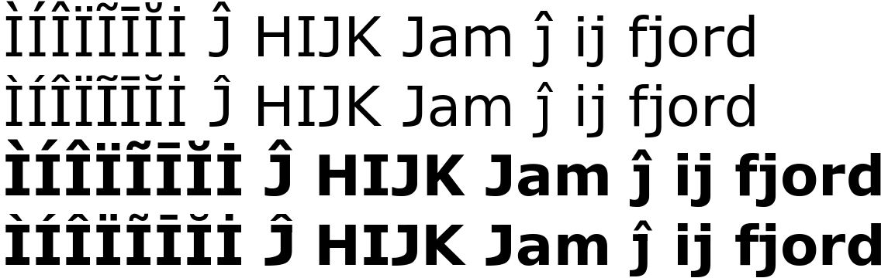
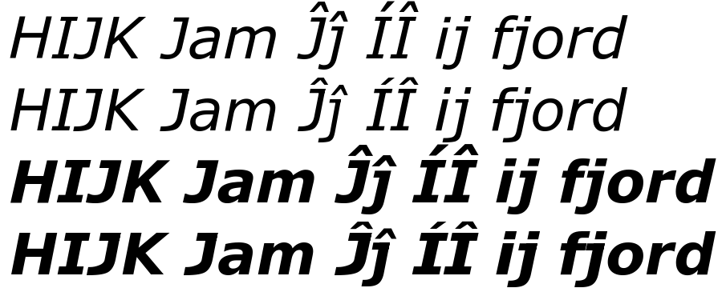

# Dejardana

Dejardana is [DejaVu Sans](https://dejavu-fonts.github.io/) made
metric-compatible with Verdana: text set in it occupies the same space as the
same text set in Verdana — the same advance widths, the same glyph positions,
the same line height — so it can stand in for Verdana where Verdana is not
available. Regular, bold, italic and bold italic.

Compared with DejaVu Sans, `scripts/make_dejardana.py` gives every glyph both families
have Verdana's advance width and ink position, adopts Verdana's vertical
metrics, and redraws the letters whose shape differs most in Verdana's manner:
capital I with top and bottom bars; capital J and lowercase j with a
right-hand stem and a long tail (J's hook resting on the baseline under a top
bar, j's stem carrying a top-left serif); accents over I and J at Verdana's
offsets. The oblique faces are un-slanted by their italic angle before the
letters are reshaped and slanted back afterwards. Kerning and layout tables are
not carried over. The face is renamed as the Bitstream Vera and DejaVu licences
require for modified fonts; see `LICENSE`.

## Files

| | |
|---|---|
| `ttfs/Dejardana-{Regular,Bold,Italic,BoldItalic}.ttf` | the fonts |
| `scripts/make_dejardana.py` | builds one face from a DejaVu Sans TTF and the reference measurements |
| `scripts/extract_metrics.py` → `verdana-metrics.json` | advance widths, ink extents and vertical metrics of the reference family's four styles |
| `scripts/measure_accents.py` → `verdana-accents.json` | accent offsets over I and J, read off rasterised glyphs |
| `scripts/build.sh` | rebuilds all four faces into `ttfs/` |
| `dejavu-fonts/` | the DejaVu Sans sources, as a submodule pinned to release 2.37 |

## Building

The inputs are the DejaVu Sans TTFs — regular, bold, oblique and bold oblique —
and the reference measurements in this repository.

    git submodule update --init            # DejaVu Sans 2.37 sources
    python3 -m venv .venv && .venv/bin/pip install fonttools pillow

DejaVu's own `Makefile` builds its TTFs from the sources with FontForge
(`make -C dejavu-fonts`, see `dejavu-fonts/BUILDING.md`); a distribution's
package of the same release works just as well (Debian `fonts-dejavu-core`
installs them under `/usr/share/fonts/truetype/dejavu/`). Then:

    scripts/build.sh /path/to/dejavu/ttfs   # writes ttfs/Dejardana-*.ttf

or one face at a time:

    .venv/bin/python scripts/make_dejardana.py DejaVuSans-Oblique.ttf verdana-metrics.json ttfs/Dejardana-Italic.ttf --italic --accents verdana-accents.json

To re-extract the measurements from a Verdana you have (ImageMagick is needed
for the accent offsets):

    .venv/bin/python scripts/extract_metrics.py Verdana.ttf "Verdana Bold.ttf" "Verdana Italic.ttf" "Verdana Bold Italic.ttf" verdana-metrics.json
    .venv/bin/python scripts/measure_accents.py Verdana.ttf "Verdana Bold.ttf" verdana-accents.json

The committed fonts were built from DejaVu Sans 2.37 with the measurements of
the Verdana 5.x shipped with macOS 15.
